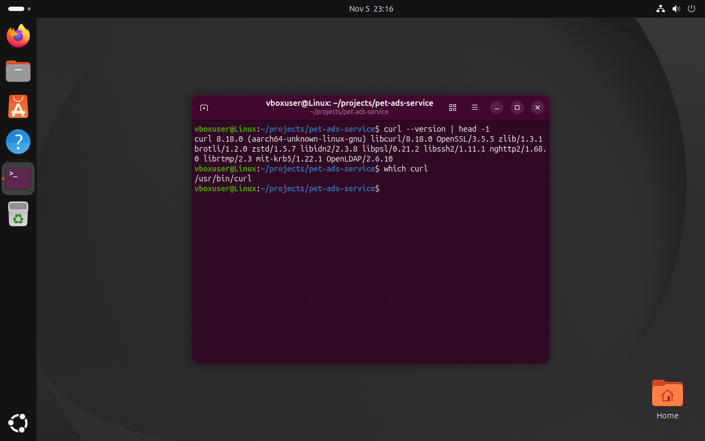

# Отчёт по КП Linux

**Проектная тема:** Pet Ads Service — сервис объявлений о животных
**Студент:** Орданян А. Г., группа ИСП9-Кh31

## 1. Linux-окружение
Ubuntu 26.04.1 LTS (arm64, aarch64) установлена в Oracle VirtualBox 7.2 на Mac с Apple Silicon: 10 ядер процессора, 8 ГБ ОЗУ, виртуальный диск 13 ГБ.
При установке создан пользователь `vboxuser`, имя машины `Linux`. Работа выполнялась в приложении Terminal.


## 2. Рабочая папка проекта
Папка проектов `~/projects`, внутри неё папка темы `pet-ads-service`.

```bash
mkdir -p ~/projects/pet-ads-service
cd ~/projects/pet-ads-service
pwd
```


## 3. Файлы проекта
Создан файл `notes.txt` и записаны три строки о проекте: первая через `>` (создать файл), следующие через `>>` (дописать в конец). Аналогично создан `README.md`, содержимое проверено `cat`.
Затем файл скопирован, а копия переименована:

```bash
cp notes.txt notes-copy.txt
mv notes-copy.txt notes-backup.txt
ls
```


## 4. Права доступа
Права просмотрены командой `ls -la` и изменены через `chmod`:

- `chmod 600 notes-backup.txt` — резервную копию заметок может читать и менять только владелец (`-rw-------`);
- `chmod 755 README.md` — владелец может всё, остальные только читать и запускать (`-rwxr-xr-x`).


## 5. Установка пакета через apt
```bash
sudo apt update && sudo apt install -y curl
curl --version | head -1
which curl
```
`sudo` запрашивает пароль пользователя, так как установка пакетов меняет систему.
`curl` нужен в следующих КП для запросов к API контейнера.




## 6. История команд


## Список использованных команд
| Команда | Назначение |
|---------|-----------|
| `whoami`, `pwd` | текущий пользователь и папка |
| `mkdir -p` | создание папок |
| `cd` | переход в папку |
| `echo >`, `echo >>`, `cat` | создание файла, дозапись строк и просмотр |
| `head`, `uname -m` | версия системы и архитектура |
| `curl --version`, `which` | проверка установленного пакета |
| `cp`, `mv` | копирование и переименование |
| `ls`, `ls -la` | список файлов и права доступа |
| `chmod` | изменение прав |
| `sudo apt update`, `sudo apt install` | обновление списка пакетов и установка |
| `history` | история команд |
