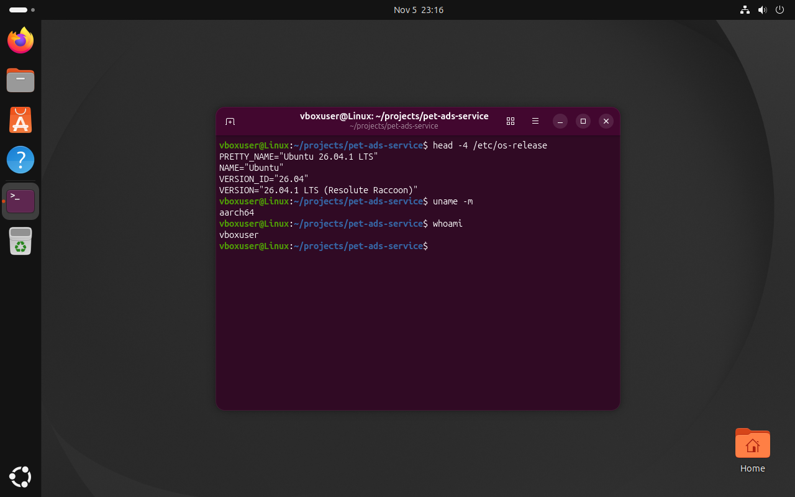
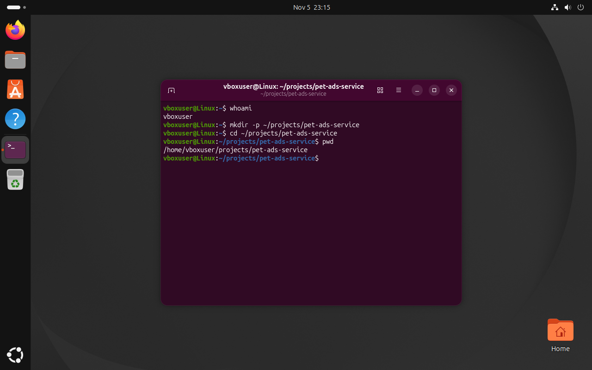
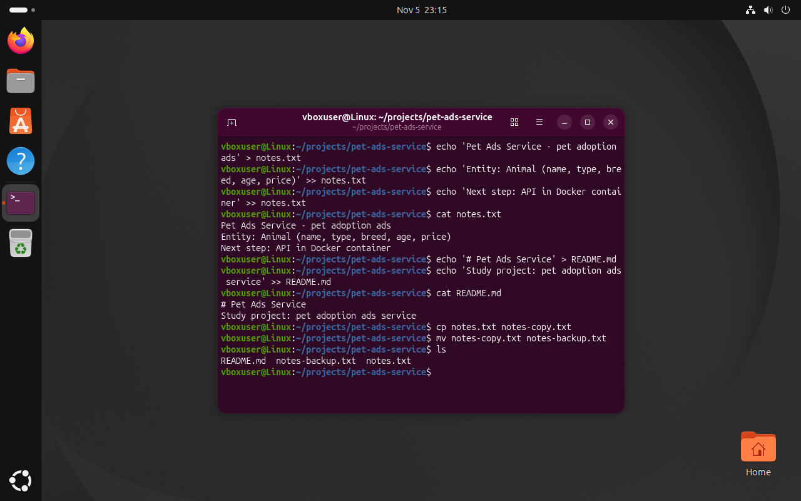
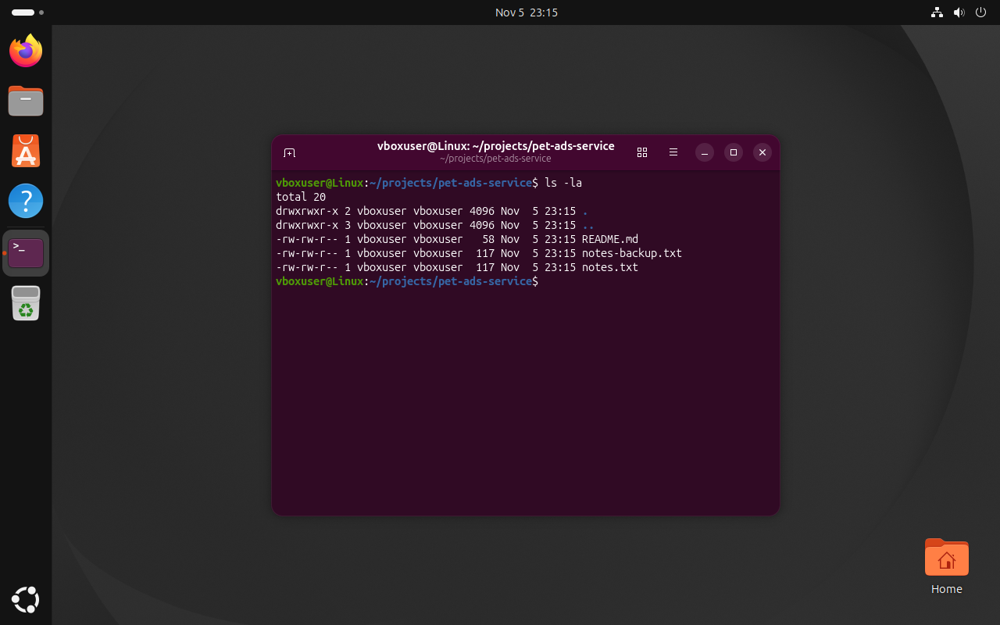
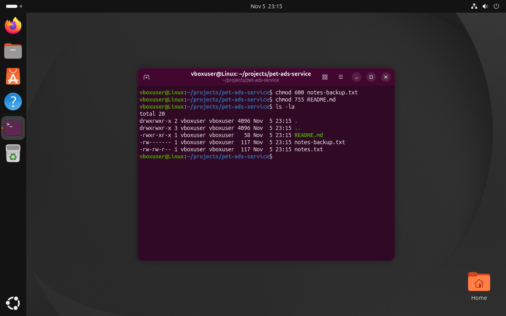
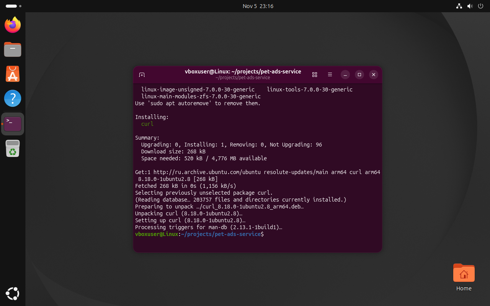
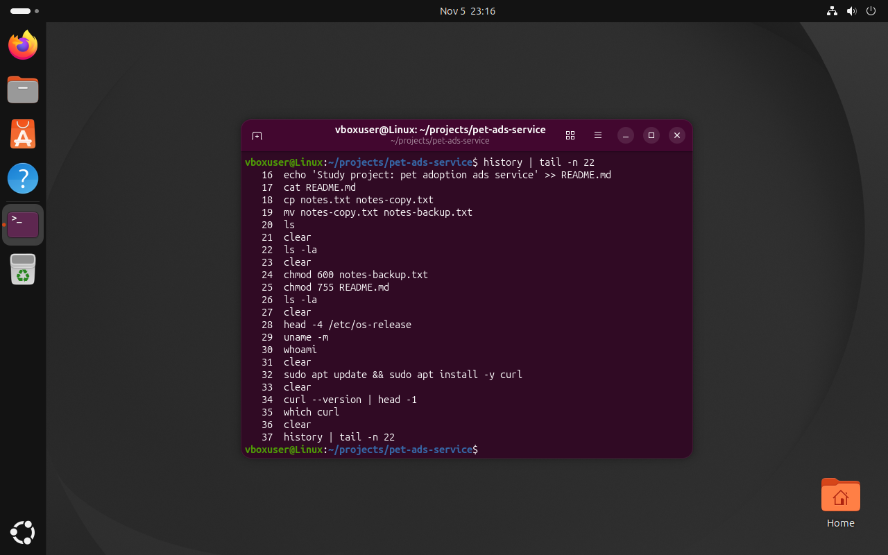

# Отчёт по КП Linux

**Проектная тема:** Pet Ads Service — сервис объявлений о животных
**Студент:** Орданян А. Г., группа ИСП9-Кh31

## 1. Linux-окружение
Ubuntu 24.04 LTS установлена в Oracle VirtualBox: 2 ядра процессора, 4 ГБ ОЗУ, диск 25 ГБ.
При установке создан пользователь `artur`. Работа выполнялась в приложении Terminal.



## 2. Рабочая папка проекта
Папка проектов `~/projects`, внутри неё папка темы `pet-ads-service`.

```bash
mkdir -p ~/projects/pet-ads-service
cd ~/projects/pet-ads-service
pwd
```



## 3. Файлы проекта
Создан `notes.txt` (редактор nano, несколько строк о проекте) и `README.md`.
Файл скопирован и копия переименована:

```bash
cp notes.txt notes-copy.txt
mv notes-copy.txt notes-backup.txt
ls
```



## 4. Права доступа
Права просмотрены командой `ls -la` и изменены через `chmod`:

- `chmod 600 notes-backup.txt` — резервную копию заметок может читать и менять только владелец (`-rw-------`);
- `chmod 755 README.md` — владелец может всё, остальные только читать и запускать (`-rwxr-xr-x`).




## 5. Установка пакета через apt
```bash
sudo apt update
sudo apt install -y curl
curl --version
```
`curl` нужен в следующих КП для запросов к API контейнера.



## 6. История команд


## Список использованных команд
| Команда | Назначение |
|---------|-----------|
| `whoami`, `pwd` | текущий пользователь и папка |
| `mkdir -p` | создание папок |
| `cd` | переход в папку |
| `nano`, `echo >`, `cat` | создание, запись и просмотр файлов |
| `cp`, `mv` | копирование и переименование |
| `ls`, `ls -la` | список файлов и права доступа |
| `chmod` | изменение прав |
| `sudo apt update`, `sudo apt install` | обновление списка пакетов и установка |
| `history` | история команд |
